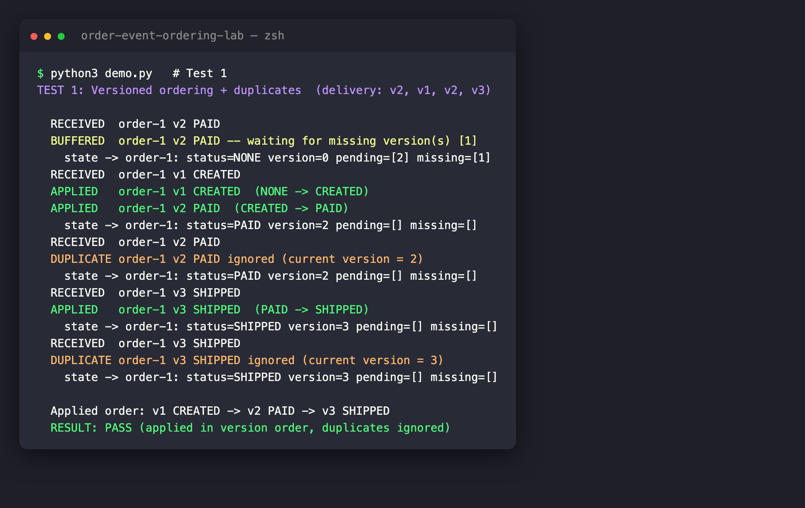
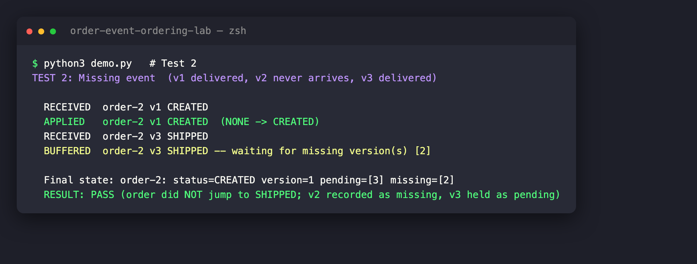
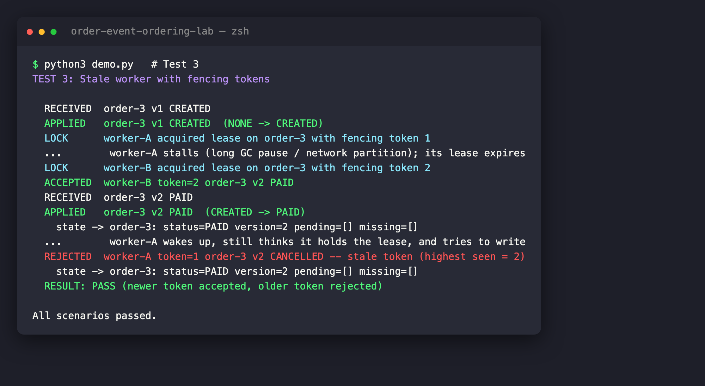
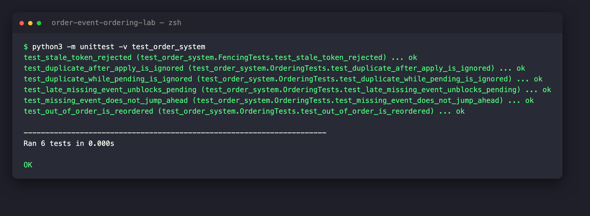

# Order Event Ordering Lab

A small order-processing simulation where each order moves through versioned states:

```
v1 CREATED  →  v2 PAID  →  v3 SHIPPED
```

Events can arrive **late**, **out of order**, or **more than once**. The program:

- applies each order's events strictly in version order,
- buffers an event that arrives early until the missing version shows up,
- ignores duplicates (whether already applied or already buffered),
- uses **fencing tokens** so a stale worker cannot overwrite newer state.

Plain Python 3, no dependencies.

## Files

| File | Purpose |
|------|---------|
| `order_system.py` | `OrderEvent`, `OrderStore` (ordering, buffering, dedup, fencing check), `LockService` (issues increasing fencing tokens) |
| `demo.py` | Runs the three required scenarios and prints a log |
| `test_order_system.py` | Unit tests for every requirement |
| `demo_output.txt`, `test_output.txt` | Captured output from the runs below |
| `screenshots/` | Screenshots of the program and tests running |

## How to run

```bash
git clone <this repo>
cd order-event-ordering-lab
python3 demo.py                              # run the three scenarios
python3 -m unittest -v test_order_system     # run the unit tests
```

Requires Python 3.8+.

## How it works

Every event carries `order_id`, `version`, and `status`. For each order the store keeps the last applied `version`, a `pending` buffer, and the highest fencing token seen.

When an event arrives:

1. **`version <= current` or already in `pending`** → duplicate, ignored.
2. **`version == current + 1`** → applied, then any buffered events that are now next in line are applied too.
3. **`version > current + 1`** → there is a gap, so the event is held in `pending` and the missing versions are logged. The order's state does not change.

For worker writes, `LockService` gives each lease a token that is always larger than the last one. `OrderStore.write_with_token` remembers the highest token that has written to each order and rejects any write with a smaller token.

## Evidence

### 1. Correct event ordering and duplicate handling

Delivery order: **v2, v1, v2 (again)**, then v3 and a duplicate v3.



Terminal log:

```
TEST 1: Versioned ordering + duplicates  (delivery: v2, v1, v2, v3)
======================================================================
  RECEIVED  order-1 v2 PAID
  BUFFERED  order-1 v2 PAID -- waiting for missing version(s) [1]
    state -> order-1: status=NONE version=0 pending=[2] missing=[1]
  RECEIVED  order-1 v1 CREATED
  APPLIED   order-1 v1 CREATED  (NONE -> CREATED)
  APPLIED   order-1 v2 PAID  (CREATED -> PAID)
    state -> order-1: status=PAID version=2 pending=[] missing=[]
  RECEIVED  order-1 v2 PAID
  DUPLICATE order-1 v2 PAID ignored (current version = 2)
    state -> order-1: status=PAID version=2 pending=[] missing=[]
  RECEIVED  order-1 v3 SHIPPED
  APPLIED   order-1 v3 SHIPPED  (PAID -> SHIPPED)
    state -> order-1: status=SHIPPED version=3 pending=[] missing=[]
  RECEIVED  order-1 v3 SHIPPED
  DUPLICATE order-1 v3 SHIPPED ignored (current version = 3)
    state -> order-1: status=SHIPPED version=3 pending=[] missing=[]

  Applied order: v1 CREATED -> v2 PAID -> v3 SHIPPED
  RESULT: PASS (applied in version order, duplicates ignored)
```

- v2 arrives first, so it is **buffered** (the order stays at `NONE`) and v1 is reported missing.
- When v1 arrives, it is applied and v2 is applied right after it from the buffer.
- The second v2 is **ignored as a duplicate**, and so is the second v3.

### 2. Missing event

v1 is delivered, v2 is never delivered, and v3 is delivered.



Terminal log:

```
TEST 2: Missing event  (v1 delivered, v2 never arrives, v3 delivered)
======================================================================
  RECEIVED  order-2 v1 CREATED
  APPLIED   order-2 v1 CREATED  (NONE -> CREATED)
  RECEIVED  order-2 v3 SHIPPED
  BUFFERED  order-2 v3 SHIPPED -- waiting for missing version(s) [2]

  Final state: order-2: status=CREATED version=1 pending=[3] missing=[2]
  RESULT: PASS (order did NOT jump to SHIPPED; v2 recorded as missing, v3 held as pending)
```

The order stays at `CREATED` (v1) instead of jumping to `SHIPPED`. v3 is held in `pending` and v2 is recorded as `missing=[2]`. The unit test `test_late_missing_event_unblocks_pending` also checks that if v2 arrives later, the order catches up to `SHIPPED`.

### 3. Stale worker rejection (fencing tokens)



Terminal log:

```
TEST 3: Stale worker with fencing tokens
======================================================================
  RECEIVED  order-3 v1 CREATED
  APPLIED   order-3 v1 CREATED  (NONE -> CREATED)
  LOCK      worker-A acquired lease on order-3 with fencing token 1
  ...        worker-A stalls (long GC pause / network partition); its lease expires
  LOCK      worker-B acquired lease on order-3 with fencing token 2
  ACCEPTED  worker-B token=2 order-3 v2 PAID
  RECEIVED  order-3 v2 PAID
  APPLIED   order-3 v2 PAID  (CREATED -> PAID)
    state -> order-3: status=PAID version=2 pending=[] missing=[]
  ...        worker-A wakes up, still thinks it holds the lease, and tries to write
  REJECTED  worker-A token=1 order-3 v2 CANCELLED -- stale token (highest seen = 2)
    state -> order-3: status=PAID version=2 pending=[] missing=[]
  RESULT: PASS (newer token accepted, older token rejected)
```

worker-A gets token 1 and then stalls. Its lease expires and worker-B gets token 2 and writes `PAID`. When worker-A wakes up and tries to write with token 1, the store has already seen token 2, so the write is **rejected** and the order stays `PAID`.

### Unit test run



Terminal log:

```
test_stale_token_rejected (test_order_system.FencingTests.test_stale_token_rejected) ... ok
test_duplicate_after_apply_is_ignored (test_order_system.OrderingTests.test_duplicate_after_apply_is_ignored) ... ok
test_duplicate_while_pending_is_ignored (test_order_system.OrderingTests.test_duplicate_while_pending_is_ignored) ... ok
test_late_missing_event_unblocks_pending (test_order_system.OrderingTests.test_late_missing_event_unblocks_pending) ... ok
test_missing_event_does_not_jump_ahead (test_order_system.OrderingTests.test_missing_event_does_not_jump_ahead) ... ok
test_out_of_order_is_reordered (test_order_system.OrderingTests.test_out_of_order_is_reordered) ... ok

----------------------------------------------------------------------
Ran 6 tests in 0.000s

OK
```

## Reflection: why timestamps alone are not enough

Every machine keeps its own time, and those clocks are never quite in sync. They drift apart, and NTP can push a clock forward or pull it back, so an event that happened later can end up with an earlier timestamp. Two events can also land on the exact same timestamp, and a timestamp gives no hint that an event in between went missing, so the receiver can't tell whether it's safe to apply what it has. A simple version number for each order avoids all of this, because it counts up 1, 2, 3 no matter what any clock says, so a gap or a duplicate stands out right away. The same goes for workers: a worker that froze for a while can't trust its own clock to know its lease ran out, so the storage layer checks a fencing token that only ever goes up and rejects anyone holding an older one.
